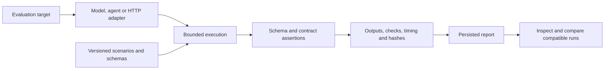
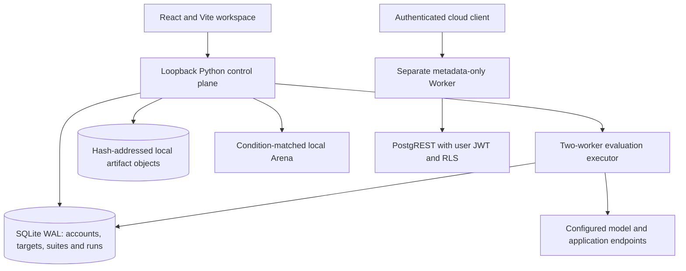

# Praxis

**Artifact-first AI evaluation with executable contracts, persisted evidence and condition-matched comparisons.**

Praxis is a local evaluation workspace and Python runner for inspecting what models, tool agents and HTTP applications actually produce. Versioned scenarios define inputs, output schemas and assertions; the runner records outputs, failures, tool traces, timing and provenance before assembling a report. A React interface supports target registration, suite authoring, run review, artifact inspection and blind preference comparisons, while a separate Cloudflare Worker exposes a limited authenticated metadata API.

**Six public suites · 40 scenarios · Three execution kinds · JSON and printable HTML reports**

[Start locally](#start-locally) · [Evaluation lifecycle](#evaluation-lifecycle) · [Suites](#suites-and-assertions) · [Comparison](#comparison-and-blind-voting) · [Recorded evidence](#recorded-validation)

## Evaluation lifecycle



The [engine](runner/praxis/engine.py) validates a suite, binds its digest and seed, dispatches the appropriate adapter, grades actual outputs and records each task's evidence. Provider errors are categorized rather than replaced with passing fixture output. A task passes only when all of its required assertions pass; application and agent contracts require the corresponding execution kind.

The local server persists events and final results in SQLite. Reports retain runner/adapter versions, suite/configuration hashes, raw outputs, assertion expectations and actual values, attempts, latency, usage when supplied and an evidence digest. Digests support integrity and comparison against a trusted record; a user-created hash does not confer independent verification.

## Suites and assertions

| Suite | Scenarios | What it exercises |
| --- | ---: | --- |
| `structured-agent` | 8 | Structured output contracts |
| `grounded-research` | 8 | Grounded responses under supplied evidence |
| `security-resilience` | 8 | Declared security and resilience contracts |
| `developer-contracts` | 8 | Developer reasoning/output requirements |
| `agent-workflows` | 4 | Executed tools and independently checked environment state |
| `http-application` | 4 | Actual HTTP response contracts |

The [scenario definitions](packages/scenarios) are public versioned JSON. Each contains passing and failing fixtures for regression testing. The first four suites assess model outputs; describing code or a website in a response is not execution of that code or rendering of that website.

Suite validation accepts 1–64 scenarios and a bounded assertion language: `equals`, `contains`, `not_contains`, `subset`, `gte` and `lte`, with positive finite weights. JSON Schema validates output shape; schema references and arbitrary Python/eval assertions are rejected. Checks address specific output paths and retain evidence for both passes and failures. JSON import, cloning and export support custom suites; public fixtures are not held-out benchmark data.

### Three execution kinds

| Target kind | Execution path | Boundary |
| --- | --- | --- |
| Model | [Adapters](runner/praxis/adapters.py) implement OpenAI-compatible chat completions, Ollama and a custom HTTP protocol. | Calls originate from the user-controlled local runner; endpoint configuration is not an operator attestation. |
| Agent | [Agent loop](runner/praxis/agent.py) invokes allowed tools against an in-memory purchase/policy environment and records before/after state. | Tool permissions, bounded steps and state assertions evaluate actual behavior; the environment is a defined simulation. |
| Application | [HTTP contracts](runner/praxis/application.py) send bounded GET/POST requests and grade status/body/content-type values. | POST requires explicit `allow_mutation:true`; only target owned or authorized applications. |

Network adapters use deadlines, response-size bounds, endpoint validation, redirect rejection and safe error messages. Credentials are resolved from the runner environment and excluded from target registry metadata. OpenAI-compatible endpoints include `/v1`; Ollama endpoints use the server origin. The custom model protocol sends `praxis.model.v1` with an input, model, seed and token bound, and expects an `output` field.

`demo` and `demo-failing` are explicit deterministic providers for testing infrastructure. Model fixtures return prescribed outputs; agent fixtures execute prescribed tool actions. They are labeled demo evidence and do not measure neural inference quality. External model endpoints remain self-reported even when their requests execute successfully.

## Local architecture and ownership



The local [server](runner/praxis/server.py) uses salted PBKDF2 password hashes, hashed expiring bearer sessions, record-owner checks, host/origin restrictions and request limits. Private records are accessed through the current owner. A two-worker executor runs evaluations; events and results survive process restarts, while interrupted active runs are marked interrupted. Cancellation is observed between calls and adapter requests have timeouts; individual tasks are not resumable.

SQLite WAL holds registry and evaluation records. Uploaded objects are SHA-256 deduplicated beside the database under `.praxis/`; back up both metadata and objects. Run-request idempotency and persisted match assignment prevent duplicate local operations within their implemented scope. The workspace is intended for a single computer, with a default 500-record list cap.

The separate [Worker](apps/api/src/index.ts) validates Supabase bearer tokens and forwards user JWTs to PostgREST so database RLS remains authoritative. It stores bounded metadata and self-reported evidence; it does not fetch custom model endpoints or execute user workloads. The local login/Arena runtime is not automatically converted into a hosted product by changing an API URL. See [cloud boundaries](docs/cloud.md), [security](docs/security.md), and the [SQL schema](supabase/schema.sql).

## Comparison and blind voting

Praxis pairs outputs only when task identity, suite digest/version, seed, target kind, token/temperature/timeout conditions, MIME type and trust are compatible. Different target identities are required. This prevents a change in evaluation conditions from silently becoming a model-quality comparison, although public tasks and user-controlled endpoints still constrain interpretation.

The local Arena:

- Includes only explicitly public run artifacts; private uploads remain private.
- Randomizes A/B order once, persists the assignment and hides identity metadata until a vote.
- Excludes self-voting and reuses an outstanding assignment for repeated pairing requests.
- Enforces one vote per account/match with a database primary key.
- Recomputes descriptive Elo-like ratings within condition/trust groups; fewer than 20 votes is labeled insufficient evidence.
- Stores `both_bad` feedback without changing relative Elo.

Ratings are community preferences within a group, not globally calibrated model capability scores. Objective rankings remain empty without an operator-controlled trusted-runner system; uploaded scores, client trust flags and local signatures cannot grant verified status. See the [architecture](docs/architecture.md) and [ownership/concurrency regressions](tests/test_api.py).

### Statistical summaries

Reports distinguish task pass rate, weighted assertion rate, per-category totals, executed/not-run counts and p50/p95 task timing. Pass rate uses the suite's total task count, retaining unexecuted tasks in the denominator. Wilson intervals summarize observed task passes under that suite; public scenarios and related tasks do not establish independent population sampling or broad generalization. Task timing includes the execution/attempt path and must be interpreted with its adapter, retry and runtime configuration. Usage can be recorded while monetary cost remains explicitly unknown.

## Artifact inspection and deterministic worlds

The upload boundary accepts up to 1 MiB and inspects bytes for supported text/JSON/HTML, PNG/JPEG/GIF, WAV, MP4 and WebM types. HTML is inert text rather than primary-origin execution. WAV duration and selected image dimensions are measured; video metadata can remain unknown without a media probe. This is artifact inspection and human preview, not an image/video-quality model.

The [world engine](runner/praxis/worlds.py) mutates explicit entities and records transitions and snapshot hashes in customer-support, research, workflow and web-product domains. A bounded deterministic reference policy drives progression from 1 to 5 to 12 entities when its measured state conditions succeed. Same-spec/seed replay checks deterministic behavior. These worlds are separate from external-model-driven tool-agent evaluation.

The website checker runs a source-controlled owned fixture with outbound network blocked and no inherited browser credentials. Arbitrary generated executable HTML/code is rejected without a configured external isolation boundary; a browser context alone is not treated as a robust sandbox.

## Start locally

Requirements: **Python 3.12+**, **Node.js 22+**, npm, and a POSIX-compatible shell for the setup script. The [manifest](pyproject.toml) requires Python 3.12; [setup](scripts/setup.sh) expects the `python3.12` executable. No cloud account or model download is required for demo fixtures.

From the repository root:

```sh
./scripts/setup.sh
npm run dev
```

Open `http://127.0.0.1:5173`. Create a local account with a password of at least 10 characters. The Python API listens on loopback port 8787. Keep this local control plane private.

For the built web interface and API in one process:

```sh
npm run build
.venv/bin/python -m praxis.server
```

Open `http://127.0.0.1:8787`. Build produces the web bundle, shared contracts/Worker checks, Worker bundle and Python runner wheel; its manifest records output hashes and exit codes. The wheel distributes the runner/CLI and bundled scenarios; start the complete local web workspace from the repository.

### Inspect the evaluation path without inference

```sh
.venv/bin/praxis suites list
.venv/bin/praxis validate packages/scenarios/structured-agent-v1.json
.venv/bin/praxis run --provider demo --suite structured-agent --output work/fixture-run.json
.venv/bin/praxis report work/fixture-run.json --output work/fixture-report.html
.venv/bin/praxis run --kind agent --provider demo --suite agent-workflows --output work/agent-fixture.json
.venv/bin/praxis world --domain customer-support --seed 73 --output work/world.json
```

The report shows demo trust, actual assertion records and evidence hashes. A `demo-failing` run deliberately returns a nonzero CLI exit status when its assertions fail.

### Evaluate a configured model

In Models, register a target without secrets, test its connection, select a compatible suite and launch a run. If needed, set `PRAXIS_MODEL_API_KEY` in the process environment before starting the local server. Connection tests make real requests and can consume provider usage.

For an already provisioned local Ollama model:

```sh
.venv/bin/praxis run --provider ollama \
  --endpoint http://127.0.0.1:11434 --model YOUR_MODEL \
  --suite structured-agent --output work/model-run.json
.venv/bin/praxis report work/model-run.json --output work/model-report.html
```

The model must already be available to its serving endpoint. A benchmark failure produces a nonzero CLI exit status while retaining its result file for inspection.

## Recorded validation

| Evidence | Recorded outcome | Interpretation |
| --- | --- | --- |
| [SmolLM2-135M ONNX acceptance](evidence/release/real-SmolLM2-135M-Instruct-ONNX-acceptance.json) | Real local CPU HTTP invocation, output persistence and grading accepted; **0/8 benchmark tasks passed**. | The evaluation path executed; model performance on these tasks was unsuccessful. |
| [SmolLM2-360M ONNX acceptance](evidence/release/real-SmolLM2-360M-Instruct-ONNX-acceptance.json) | Same acceptance scope; **0/8 benchmark tasks passed**. | Successful inference transport is distinct from passing assertions. |
| [Native PostgreSQL receipt](evidence/release/postgres-host-passed.json) | Empty schema, ownership/trust regressions, RLS across 28 tables and persistence checks passed. | Local `auth.uid`/JWT-claim compatibility fixture; not hosted Supabase Auth acceptance. |
| [Committed browser receipt](evidence/release/browser/result.json) | Failed on a timed-out UI interaction. | This receipt does not establish complete browser acceptance. |
| [Verification CI](https://github.com/akilanpl/praxis/actions/runs/41677443216) and [pushgate](https://github.com/akilanpl/praxis/actions/runs/41677443188) | Both completed successfully at source `3d0beaf71fc0f6f0b87b93370bafcccbba9693d8`. | Named GitHub run outcomes; inspect their artifacts for the checks and environments they cover. |

The real-model receipt files link run IDs and evidence hashes to the [raw 135M report](evidence/release/real-SmolLM2-135M-Instruct-ONNX.json) and [raw 360M report](evidence/release/real-SmolLM2-360M-Instruct-ONNX.json). They remain self-reported research records, not an official leaderboard certification.

[VERIFICATION.md](VERIFICATION.md) and [the committed gate receipt](evidence/release/latest-gate.json) preserve earlier checkpoints, including environment-blocked or incomplete acceptance. They are historical records, not a blanket description of every later run. Keep source identity and evidence scope when comparing them with current CI; no public deployment or hosted Auth success follows from these local results.

### Run checks

```sh
npm test
npm run typecheck --workspace packages/contracts
npm run typecheck --workspace apps/api
npm run build
```

The [Python tests](tests) cover schema/negative fixtures, adapters, executable-agent/application contracts, persistence, owner isolation, concurrent voting/matching, idempotency and artifact boundaries. The [Worker tests](apps/api/test/security.test.ts) exercise token, ownership, origin, size and trust behavior with controlled transport.

Optional browser verification requires its own browser environment:

```sh
.venv/bin/python -m pip install -e '.[browser]'
PLAYWRIGHT_BROWSERS_PATH=./work/browsers .venv/bin/python -m playwright install chromium
PLAYWRIGHT_BROWSERS_PATH=./work/browsers .venv/bin/python scripts/browser_check.py
PLAYWRIGHT_BROWSERS_PATH=./work/browsers .venv/bin/praxis check-website --output-dir evidence/website
```

These commands require local socket/browser permissions. Browser and integration scripts write their own evidence; run them in an isolated verification checkout when preserving existing receipts. The full release gate has additional model, browser, PostgreSQL and audit prerequisites defined in its workflow.

## Code map

| Path | Responsibility |
| --- | --- |
| `runner/praxis/engine.py` | Suite validation, invocation, assertions, summaries and evidence digest |
| `runner/praxis/adapters.py`, `agent.py`, `application.py` | Model protocols, bounded tools and HTTP contracts |
| `runner/praxis/server.py` | Local accounts, persistence, execution jobs, artifact access and Arena |
| `runner/praxis/worlds.py`, `artifact_checks.py`, `media.py` | Deterministic worlds and bounded artifact inspection |
| `packages/scenarios/`, `packages/contracts/` | Versioned evaluation definitions and shared API contracts |
| `apps/web/`, `apps/api/` | Local React interface and separate metadata Worker |
| `supabase/` | SQL schema, migrations and ownership/persistence checks |
| `tests/`, `evidence/`, `scripts/` | Regressions, recorded receipts, build and acceptance tooling |

Documentation basis: [`3d0beaf71fc0f6f0b87b93370bafcccbba9693d8`](https://github.com/akilanpl/praxis/tree/3d0beaf71fc0f6f0b87b93370bafcccbba9693d8), on the default branch `feature/qa-hardening-release`. Distributed under the [MIT license](LICENSE), copyright Praxis contributors.
